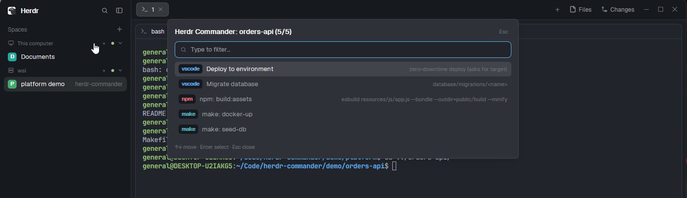
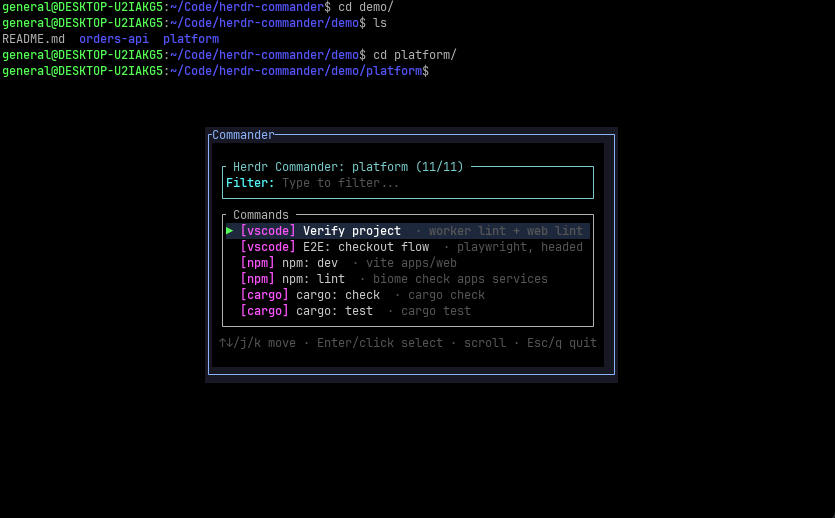

# herdr-commander

> Universal task runner, command palette and build orchestrator for [Herdr](https://herdr.dev) — one repo, two flavors.

`herdr-commander` gives Herdr a unified command launcher with zero runtime
dependencies. It discovers the tasks your project already defines, filters
them as you type, and runs them where you want: a new tab, a split pane, or
the terminal you are in.

| | TUI plugin (classic `herdr`) | GUI mod (`herdr-app`) |
|---|---|---|
| Runtime | standalone Rust binary (~1.5 MB, ratatui + crossterm) | JavaScript mod (gpui-kit), no toolchain |
| Install | `herdr plugin install lurepos/herdr-commander` | copy/symlink `mods/commander-gui/` into the app home |
| Open with | your `plugin_action` key (e.g. `f1`) | `f1` via `mod.open`, or the command palette |
| Manifest | `herdr-plugin.toml` | `mods/commander-gui/mod.json` |

This README is the project's single documentation file. It centralizes
install, configuration, usage, the demo projects and the development
workflow for both flavors.

---

## What it looks like

### herdr-app mod (GUI popup palette)



Popup near the top of the window: header with workspace name and a
`(filtered/total)` counter, filter input with accent border, and one row per
task — colored source tag (`vscode` / `npm` / `cargo` / `make`), task label,
and the resolved command or detail. `Esc` closes; placement and input screens
reuse the same palette.

### herdr classic plugin (TUI picker)



Transient pane popup: `Herdr Commander: <workspace> (n/total)` header, filter
line, boxed task list with `▶` selection pointer and `[badge]` origin tags,
footer key hints. Same flow, native terminal rendering.

---

## How it works

Both flavors share one discovery spec and one interaction flow; only the
renderer and runner differ.

### Task discovery (automatic)

Walks up from the focused terminal's folder looking for `.vscode/tasks.json`
(the TUI searches to the filesystem root; the GUI mod caps the walk at 16
levels), then reads the siblings of the workspace it finds:

| Source | What surfaces |
|---|---|
| `.vscode/tasks.json` | full tasks (JSONC: comments and trailing commas), `options.cwd`/`env`, `dependsOn` (string or array), `dependsOrder` (`sequence`/`parallel`), `detail`, VS Code `inputs` |
| `package.json` | every script, sorted, shown as `npm: <name>` with the script body as detail |
| `Cargo.toml` | five presets: `cargo: check`, `test`, `build`, `build --release`, `clippy` |
| `Makefile` | every declared target (recipe lines, assignments and duplicates are never mistaken for targets) |

Variable expansion before running: `${workspaceFolder}`, `${env:NAME}`
(resolved on the machine that will run the task) and `${input:ID}`.
Tasks.json labels win over generated ones on collision.

### Flow: task → placement → inputs → run

1. Pick a task from the palette (type to filter — substring over label, tag
   and detail).
2. Pick a placement:

   | Placement | TUI | GUI mod |
   |---|---|---|
   | New tab | `herdr tab create` | `run("tab.new", { argv, name })` |
   | Right split | `herdr pane split` | `run("pane.split", { direction: "right", argv })` |
   | Bottom split | `herdr pane split` | `run("pane.split", { direction: "down", argv })` |
   | Current pane | text injected into the focused pane | `hc send` to the focused terminal |

3. If the task (or its transitive dependencies) references inputs, the
   palette asks first: `pickString` as a list, `promptString` as a text
   field pre-filled with the default. Esc on an input cancels the whole run.
4. Run. Dependencies execute first — sequential chains fail fast; parallel
   trees run concurrently. The TUI supervises each command in its own
   process group (`PGID`), so `Ctrl+C` kills the whole tree without
   orphans; the GUI mod composes one shell line per launch (`cd '<cwd>' && …`,
   `&&` chains, `a & b & wait` for parallel) and hands it to herdr-core.

### Keys

| | TUI | GUI mod |
|---|---|---|
| Move | `↑`/`↓`, `j`/`k` (when the filter is empty), wheel | `↑`/`↓` |
| Select / run | `Enter` or click | `Enter` or click |
| Back / cancel | `Esc` (placement: back), `q` quit | `Esc` (placement: back; input: cancel) |
| Filter | just type, `Backspace` erases | just type in the input |

---

## Installation

### herdr classic (TUI plugin)

```bash
herdr plugin install lurepos/herdr-commander
herdr plugin list        # verify
```

Local checkout instead of a release:

```bash
herdr plugin link .
```

### herdr-app (GUI mod)

```bash
git clone https://github.com/lurepos/herdr-commander
ln -s "$PWD/herdr-commander/mods/commander-gui" ~/.config/herdr-app/mods/commander-gui
```

Windows: the app home is `%USERPROFILE%\.config\herdr-app` — copy the folder
there instead of symlinking. Developing from WSL against a Windows install:

```bash
scripts/sync-mod.sh        # copy the mod over (hot reload picks it up)
scripts/sync-mod.sh check  # + herdr-app.exe check
```

Then bind a key (or open it from the command palette → Commander).

---

## Configuration

### TUI (`~/.config/herdr/config.toml`)

```toml
[[keys.command]]
key = "f1"
type = "plugin_action"
command = "herdr.commander.open-picker"
description = "Open Herdr Commander"
```

Reload without restarting: `herdr server reload-config`.

### GUI (`~/.config/herdr-app/keys.json`, `"global"` section — `%USERPROFILE%\.config\herdr-app\keys.json` on Windows)

```jsonc
"f1": { "command": "mod.open", "args": { "name": "commander-gui" } }
```

Save → live reload. A second `mod.open` replaces the open palette; `Esc`
inside closes it.

---

## Usage

1. Press your key (`f1` in the examples) with a terminal focused on your
   project — the palette reads the focused terminal's folder.
2. Type to filter, `↑`/`↓` to move, `Enter` to choose.
3. Choose the placement.
4. Answer any inputs.
5. The task runs in the placement you chose; its terminal belongs to
   herdr-core and keeps running if the window closes.

No tasks found? Both flavors offer to generate a starter
`.vscode/tasks.json` and `Exit` (the GUI mod generates the template on POSIX
machines only).

---

## Demo projects

| Directory | Flavor | Rows | Showcases |
|---|---|---|---|
| `demo/orders-api` | TUI | 5 (vscode 2, npm 1, make 2) | `pickString`, `promptString`, `options.cwd` + `env`, `${env:}` |
| `demo/platform` | GUI | 11 (vscode 2, npm 2, cargo 5, make 2) | composite over generated tasks (cargo+npm), double-input task, cargo presets, make with variable |

Text preview without any UI:

```bash
./target/debug/herdr-commander --dump-tasks demo/orders-api
./target/debug/herdr-commander --dump-tasks demo/platform
```

All demo stub scripts are `echo`-only; running them is safe. The
`cargo:` presets in `demo/platform` really run (tiny crate).

---

## Development

```
├── herdr-plugin.toml      TUI manifest (plugin manager reads this)
├── src/                   TUI: config.rs, discovery.rs, runner.rs, ui.rs, main.rs
├── mods/commander-gui/    GUI mod: main.js (palette), discover.js (pure logic), mod.json
├── demo/                  demo workspaces (also parity fixtures)
├── scripts/sync-mod.sh    WSL → Windows mod sync
└── .github/workflows/     test.yml: cargo test + bun test; release.yml: tagged builds
```

```bash
cargo test                      # TUI unit tests (12)
bun test mods/commander-gui/    # GUI discovery tests + cross-checks (21)
cargo build --release           # release binary
herdr plugin link .             # live-link the TUI plugin
```

**Parity is enforced by CI**: the TUI binary has a hidden
`--dump-tasks <dir>` flag that prints its discovered task list as JSON, and
`mods/commander-gui/parity.test.js` diffs it against the GUI mod's
discovery pipeline on the same trees (a synthetic fixture plus both demo
projects). Known, deliberate divergences: a string `args` in tasks.json is
tolerated per-task by the GUI mod, while the TUI rejects the whole file; and
the GUI mod's upward search for `.vscode/tasks.json` stops after 16 levels,
while the TUI walks to the filesystem root. Everything else must match.

The GUI mod is checked against the installed app too:

```bash
herdr-app check mods/commander-gui
herdr-app shot out.png   # capture the rendered palette
```
